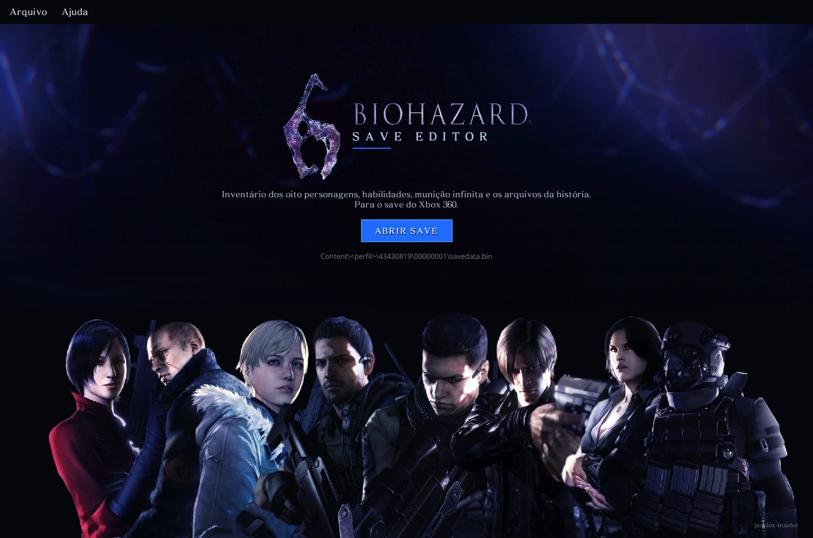
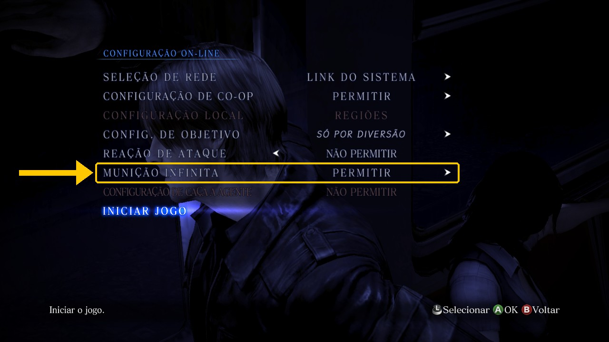
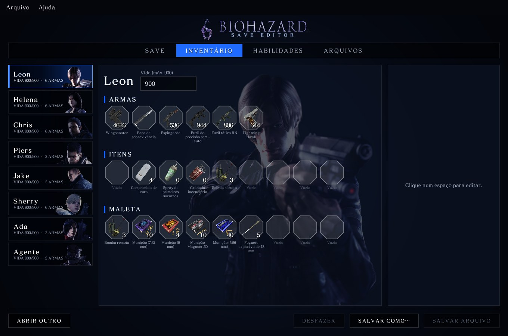
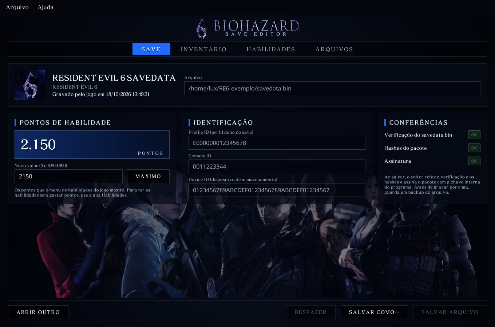
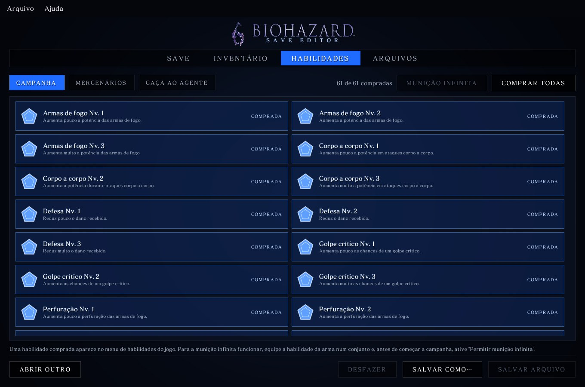
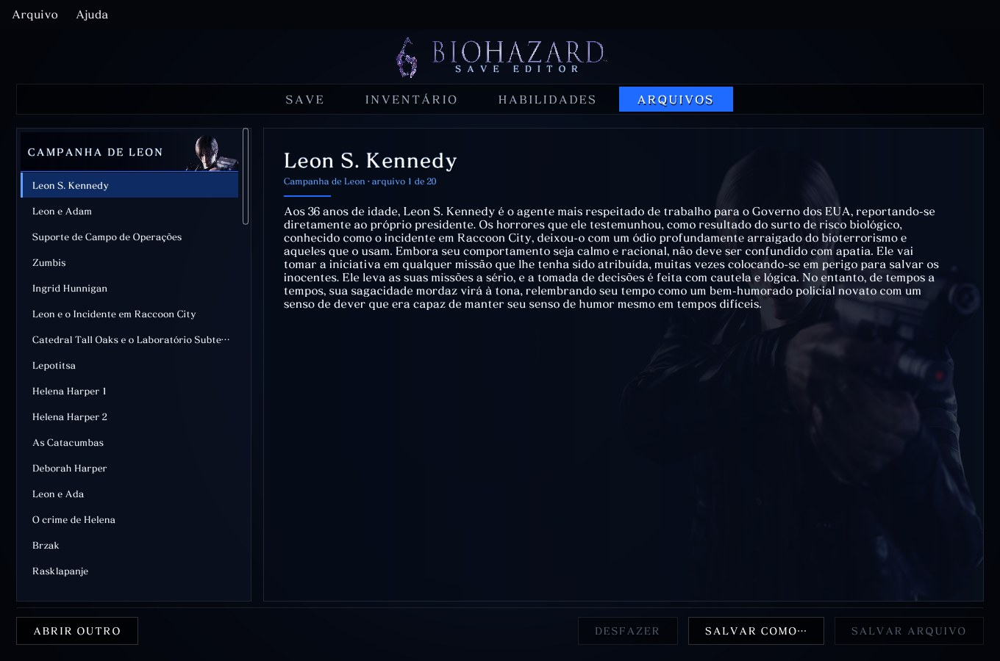

# BIOHAZARD 6 SAVE EDITOR

[](https://github.com/lux-insider/biohazard6-save-editor/releases/latest)
[](LICENSE)




Editor de save do **Resident Evil 6** para **Xbox 360** e **PC (Steam)**, em
português, com o
visual do próprio jogo: logo, tela de título, elenco, retratos dos
personagens, fonte de mensagens e os ícones originais dos itens. Programa
nativo para Windows e Linux, escrito em Rust com interface em Slint.

---

## Sumário

- [Funcionalidades](#funcionalidades)
- [Capturas de tela](#capturas-de-tela)
- [Download](#download)
- [Como usar](#como-usar)
- [Assinatura](#assinatura)
- [Segurança e integridade](#segurança-e-integridade)
- [Validação](#validação)
- [Problemas e sugestões](#problemas-e-sugestões)
- [Licença](#licença)

---

## Funcionalidades

| Recurso | Xbox 360 | PC (Steam) |
|---|:---:|:---:|
| Inventário dos 8 personagens e vida | ✓ | ✓ |
| Pontos de habilidade | ✓ | ✓ |
| As 96 habilidades | ✓ | ✓ |
| Data do save | ✓ | ✓ |
| Nome do save, perfil, console e dispositivo | ✓ | — |
| Assinatura do pacote | ✓ automática | não se aplica |

**Abas do editor**

| Aba | O que oferece |
|---|---|
| **Inventário** | Os 8 personagens (Leon, Helena, Chris, Piers, Jake, Sherry, Ada e Agente): armas do personagem (obtida ou não e balas no pente), comprimidos, spray, granadas, maleta (munição, ervas e granadas) e vida atual. |
| **Save** | Nome do save, data em que o jogo gravou, perfil, console, pontos de habilidade (até 9.999.999) e as conferências do arquivo: verificação e, no Xbox 360, hashes e assinatura. |
| **Habilidades** | As 96 habilidades do jogo (campanha, Mercenários e Caça ao Agente), com nome e descrição originais. Compra individual, de um modo inteiro ou só das 8 de munição infinita. |
| **Arquivos** | Os 80 textos da história do jogo (20 por campanha), para leitura. Esta aba não altera o save. |

Em cada espaço do inventário, o editor só oferece os itens que o jogo aceita
naquele lugar.

> **Munição infinita:** depois de comprar a habilidade, equipe-a no jogo e
> ative "Permitir munição infinita" antes de começar a campanha.
>
> Na tela **Configuração On-line**, antes de **Iniciar jogo**, deixe
> **Munição infinita** em **Permitir**:
>
> 

---

## Capturas de tela

| | |
|---|---|
|  |  |
|  |  |

As capturas usam um save com perfil, console e dispositivo fictícios.

---

## Download

Baixe a versão mais recente na página de
[**Releases**](https://github.com/lux-insider/biohazard6-save-editor/releases/latest).

| Arquivo | Sistema |
|---|---|
| `BIOHAZARD6-SAVE-EDITOR-<versão>-windows-x86_64.zip` | Windows 10 e 11 (64 bits) |
| `BIOHAZARD6-SAVE-EDITOR-<versão>-linux-x86_64.tar.gz` | Linux x86_64 |
| `SHA256SUMS.txt` | hashes para conferir os downloads |

Descompacte a pasta inteira. Não é preciso instalar nada; no Windows, o
programa não depende do Visual C++ Redistributable.

```
BIOHAZARD 6 SAVE EDITOR/
├── BIOHAZARD 6 SAVE EDITOR.exe   (Linux: biohazard6-save-editor)
├── LEIA-ME.txt                   guia rápido
├── LICENSE
├── console/                      lugar opcional do kv.bin do seu console
└── backups/                      cópia do save antes de cada gravação
```

---

## Como usar

1. **Faça backup do save.** No Xbox 360, copie a pasta `Content` do pendrive
   ou do HD; no PC, copie o `savedata.bin`.
2. Abra o programa e clique em **ABRIR SAVE**:
   - **Xbox 360:** `Content\<perfil>\43430819\00000001\savedata.bin`
   - **PC (Steam):** `Steam\userdata\<conta>\221040\remote\savedata.bin`
     (no Linux, `~/.steam/steam/userdata/<conta>/221040/remote/`). Quando a
     Steam tem o save do RE6, o diálogo já abre nessa pasta.
3. Faça as alterações e salve.
4. No Xbox 360, devolva o arquivo para a **mesma pasta** no pendrive ou no
   HD. No PC, salve com o jogo fechado.

A plataforma do save é detectada sozinha.

---

## Assinatura

Só o save do Xbox 360 é assinado; o do PC não tem pacote nem assinatura.

O save do Xbox 360 sai sempre assinado e pronto para o console, com a chave interna do
programa. Quem preferir pode colocar o `kv.bin` do próprio console em
`console/kv.bin`, ao lado do programa; ele passa a ser usado no lugar da
chave interna. O `kv.bin` é a identidade do console: não compartilhe. Ele
nunca entra no repositório.

---

## Segurança e integridade

- **Gravação segura:** o arquivo é montado e conferido em memória, gravado numa
  cópia temporária, relido e só então substitui o original.
- **Backup automático** do arquivo anterior na pasta `backups/`.
- **Conferência completa:** verificação do `savedata.bin` e, no Xbox 360,
  hashes SHA-1 do pacote e assinatura.
- **Validação na abertura:** só aceita pacotes CON do Resident Evil 6 (LIVE e
  PIRS são recusados) e o `savedata.bin` do RE6 de PC, conferindo o
  identificador e o tamanho.
- **Save de PC preservado:** o editor muda só os campos editados e a
  verificação; a marca do computador no cabeçalho fica intacta.
- **Edições restritas ao que o jogo aceita**, para evitar que o jogo descarte
  o inventário.
- **Itens no máximo do jogo:** granadas e bomba remota até 5, comprimidos de
  cura até 12, spray 1 e ervas 1 por espaço. Acima disso o jogo zera o item
  ou trava o uso (os valores vêm do executável do jogo). Armas e munição
  aceitam até 999.

---

## Validação

Todas as funções de edição foram conferidas num Xbox 360:

- o save editado carrega normalmente;
- as habilidades compradas pelo editor aparecem no menu do jogo e podem ser
  equipadas, inclusive as 8 de munição infinita;
- os pontos de habilidade gravados são os que o jogo mostra;
- o inventário editado aparece no jogo.

No PC, o formato foi levantado e conferido em dois saves reais da Steam:
abrir e salvar sem alterações devolve o arquivo idêntico byte a byte, e uma
edição muda só os bytes do campo e a verificação. O save de PC ainda não foi
testado dentro do jogo.

---

## Problemas e sugestões

Erros e ideias são bem-vindos nas [issues](https://github.com/lux-insider/biohazard6-save-editor/issues/new/choose),
com um modelo para cada caso. Para falhas de segurança, veja o
[SECURITY.md](SECURITY.md).

---

## Licença

Programa **gratuito (freeware)**, de código fechado: pode usar à vontade, mas
não pode vender, republicar em outros sites nem modificar. Os termos completos
estão no [LICENSE](LICENSE).

A interface usa o [Slint](https://slint.dev) sob a Slint Royalty-free License,
que pede o selo abaixo na página de download do programa. A fonte Noto Sans
está sob a SIL Open Font License (o `OFL.txt` vai junto no download).

*Resident Evil 6* / *BIOHAZARD 6* © CAPCOM CO., LTD. As imagens, os textos e
a fonte de mensagens do jogo (`RE6-Mensagem.ttf`, convertida da original)
pertencem à Capcom. Projeto de fã, gratuito e sem fins lucrativos, sem
ligação com a Capcom ou a Microsoft.

[](https://slint.dev)
